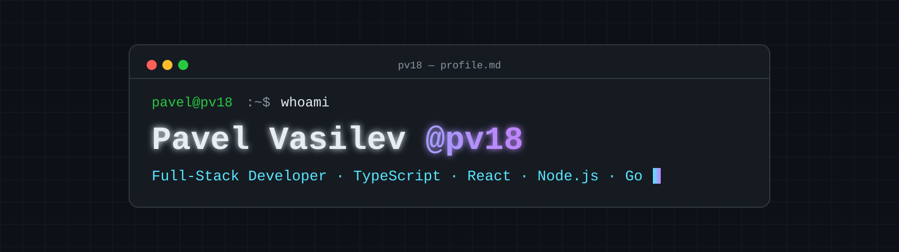

  

---

## 🔥 Streak

---

## 🐍 Вклад в коммитах

<picture>
  <source media="(prefers-color-scheme: dark)" srcset="https://raw.githubusercontent.com/pv18/pv18/output/github-contribution-grid-snake-dark.svg" />
  <source media="(prefers-color-scheme: light)" srcset="https://raw.githubusercontent.com/pv18/pv18/output/github-contribution-grid-snake.svg" />
  
</picture>

---

  

